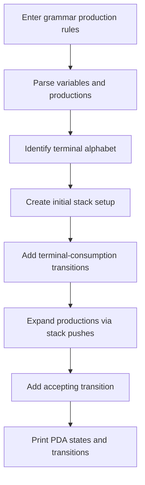

# Context-Free Grammar → Pushdown Automaton

**Formal languages · Automata theory · Python**

A Python assignment that constructs a pushdown automaton from a provided context-free grammar (CFG). It models states and transitions including stack operations and lambda (`λ`) moves.

## Construction flow



## Run

```bash
git clone https://github.com/Parand1khalili/PDA.git
cd PDA
python main2.py
```

The program first asks for the **number of rules**, followed by the CFG rules line by line. Its printed transition output includes state identifiers, input symbols, stack-top information, and actions such as `PUSH(...)` and `POP`.

| File | Purpose |
| --- | --- |
| [`main2.py`](./main2.py) | Grammar parsing, PDA state/transition construction, and output formatting |

**Limitations:** the input grammar format is specific to the course script, and the implementation has not been independently tested for arbitrary CFGs or epsilon productions. Avoid assuming that every context-free language can be processed without adapting its parser.

*Related project: [Regular Expression → NFA](https://github.com/Parand1khalili/NFA).*
